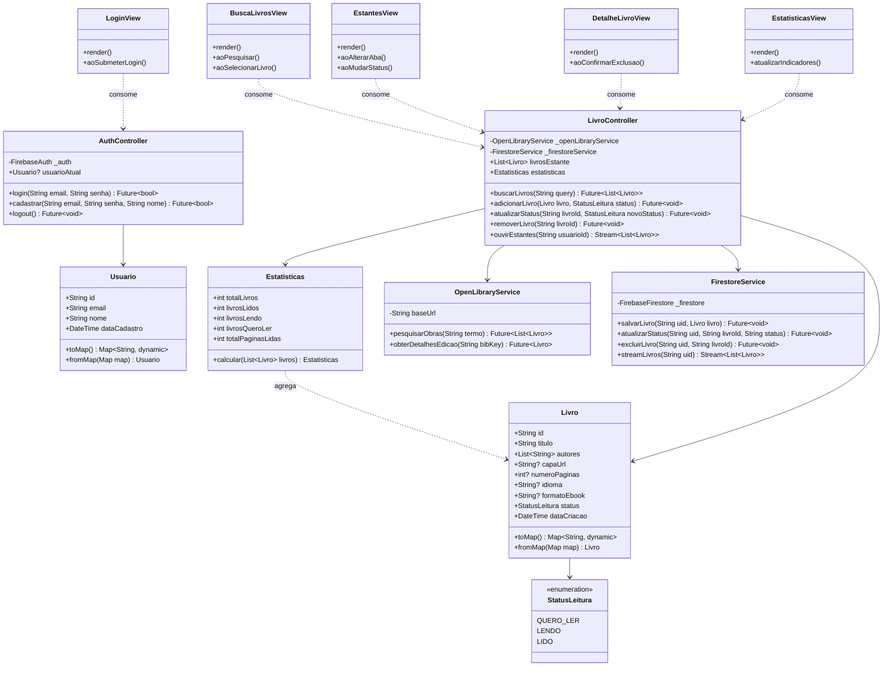
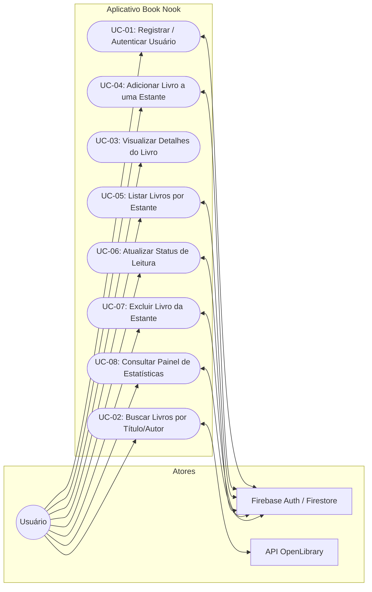

# Book Nook - Estante de Livros Digital

**Autor:** Thayssa Maneo  
**Padrão Internacional:** ISO/IEC/IEEE 29148:2018 (Engenharia de Requisitos)  
**Versão:** 1.0.0  
**Data:** 22/10/2026  

---

## 1. Introdução

### 1.1 Objetivo
O **Book Nook** é um aplicativo móvel voltado ao gerenciamento de leituras pessoais. O sistema permite pesquisar obras literárias por meio da API pública OpenLibrary, organizar títulos em estantes virtuais categorizadas (*"Quero ler"*, *"Lendo"* e *"Lidos"*), sincronizar os dados em nuvem via Cloud Firestore e calcular de forma automatizada estatísticas de progresso, incluindo volumes cadastrados e estimativa de páginas lidas.

### 1.2 Funções do Sistema
De acordo com as necessidades dos stakeholders, as funções essenciais do sistema compreendem:

1. **Gestão de Acesso e Identidade:**
   - O aplicativo deve disponibilizar registro e autenticação segura de usuários.
   - O aplicativo deve redirecionar o usuário autenticado diretamente para a tela de exploração e busca.

2. **Consulta e Descoberta de Obras:**
   - O aplicativo deve comunicar-se com a API REST OpenLibrary para consulta por título ou autor.
   - O aplicativo deve retornar metadados das edições correspondentes (título, autor, capa, idioma, formato e páginas).

3. **Gerenciamento de Estantes:**
   - O aplicativo deve permitir vincular uma obra a uma estante específica (*"Quero ler"*, *"Lendo"*, *"Lidos"*).
   - O aplicativo deve sincronizar instantaneamente as alterações de status de leitura no Cloud Firestore.
   - O aplicativo deve permitir a remoção de itens das estantes com atualização em tempo real.

4. **Consolidação de Estatísticas:**
   - O aplicativo deve calcular e atualizar dinamicamente o painel de métricas (livros totais, lidos, em andamento e soma de páginas lidas).

### 1.3 Páginas do Aplicativo
1. **Cadastro e Autenticação (`LoginView`):** Formulário para autenticação de credenciais ou registro de novas contas.
2. **Busca de Livros (`BuscaLivrosView`):** Campo de pesquisa conectado à OpenLibrary com listagem de obras, autores e edições.
3. **Estantes Virtuais (`EstantesView`):** Painel segmentado com guias ou filtros para as estantes *"Quero ler"*, *"Lendo"* e *"Lidos"*.
4. **Detalhes da Obra (`DetalheLivroView`):** Informações complementares da edição, sinopse, capa ampliada e ações de troca de estante/exclusão.
5. **Estatísticas de Leitura (`EstatisticasView`):** Indicadores consolidados de desempenho e metas de leitura do usuário.

### 1.4 Tecnologias e Bibliotecas Utilizadas
* **Linguagem & Framework:** Dart `^3.12.2` / Flutter `^3.12.0`
* **Comunicação HTTP:** `http` (integração com a API OpenLibrary)
* **Serviços em Nuvem (BaaS):**
  * `firebase_core`: Inicialização da infraestrutura Firebase
  * `firebase_auth`: Autenticação segura por e-mail e senha
  * `cloud_firestore`: Banco de dados NoSQL em tempo real para sincronização de estantes
  * `cloud_functions`: Gatilhos e funções para atualizar a tela de estatísticas

### 1.5 Endpoint base da API para buscas

O principal endpoint da API OpenLibrary utilizado para buscas é: https://openlibrary.org/search.json?q={titulodolivro}+language%3Apor

---

## 2. Requisitos do Sistema

Conforme as diretrizes da **ISO/IEC/IEEE 29148:2018**, os requisitos são formulados de maneira singular, não ambígua, verificável e utilizando a forma verbal mandatória (*deve*).

### 2.1 Requisitos Funcionais (RF)

| ID | Requisito | Descrição |
| :--- | :--- | :--- |
| **RF-01** | Autenticação de Usuário | O sistema deve permitir que o usuário crie uma nova conta e realize login utilizando e-mail e senha com validação via Firebase Auth. |
| **RF-02** | Busca de Livros | O sistema deve consultar a API OpenLibrary com base nos termos fornecidos pelo usuário e listar os títulos, autores e capas correspondentes. |
| **RF-03** | Adicionar à Estante | O sistema deve permitir ao usuário adicionar uma obra pesquisada a uma das estantes (*"Quero ler"*, *"Lendo"* ou *"Lidos"*), persistindo o registro no Cloud Firestore. |
| **RF-04** | Atualizar Status de Leitura | O sistema deve permitir a alteração da estante de um livro já cadastrado, refletindo a nova classificação imediatamente no banco de dados. |
| **RF-05** | Calcular Estatísticas | O sistema deve recalcular e exibir automaticamente o total de livros, quantidade por estante e soma de páginas lidas sempre que houver alteração nas estantes. |
| **RF-06** | Listar Livros por Estante | O sistema deve exibir os livros agrupados conforme a sua estante atual (*"Quero ler"*, *"Lendo"*, *"Lidos"*), com ordenação por data de inserção. |
| **RF-07** | Detalhar Registro | O sistema deve exibir a tela de detalhes com informações completas da edição selecionada (título, autor, capa, idioma, formato de ebook e número de páginas). |
| **RF-08** | Excluir Registro | O sistema deve possibilitar a remoção definitiva de um livro da estante do usuário, mediante diálogo de confirmação, excluindo o documento do Cloud Firestore. |

### 2.2 Requisitos Não Funcionais (RNF)

| ID | Categoria | Descrição |
| :--- | :--- | :--- |
| **RNF-01** | Desempenho | O sistema deve exibir retorno visual de carregamento (spinner/skeleton) e renderizar respostas de busca da API externa em até 3 segundos sob conexão de rede estável. |
| **RNF-02** | Confiabilidade | O sistema deve interceptar falhas de conexão de rede ou indisponibilidade de serviços externos sem fechar a aplicação, alertando o usuário via mensagens informativas. |
| **RNF-03** | Usabilidade | A interface deve aderir às diretrizes de Material Design 3, mantendo taxa de contraste adequada (WCAG 2.1 AA) e rotas acessíveis com no máximo 3 toques a partir do menu principal. |
| **RNF-04** | Segurança | O sistema deve transacionar dados exclusivamente via protocolo HTTPS/TLS e assegurar que as regras de segurança do Firestore limitem a leitura e escrita apenas ao proprietário do registro (`request.auth.uid == resource.data.userId`). |
| **RNF-05** | Portabilidade | O aplicativo deve operar de forma compatível e responsiva em dispositivos móveis Android (API nível 23 ou superior) e iOS (versão 13 ou superior). |
| **RNF-06** | Manutenibilidade | A base de código deve seguir a arquitetura MVC com separação estrita de camadas, aderindo aos princípios SOLID e mantendo métodos concisos (máximo de 20 linhas). |

---

## 3. Diagramas do Sistema

### 3.1 Diagrama de Classes UML (Padrão MVC)



---

### 3.2 Diagrama de Casos de Uso



---

## 4. Tutorial: Como Executar o App pelo Repositório GitHub

Siga os passos abaixo para clonar o repositório, instalar as dependências e executar o aplicativo em seu ambiente de desenvolvimento.

### 4.1 Pré-requisitos
* **Flutter SDK:** Versão `^3.12.0` ou superior ([Guia de instalação oficial](https://flutter.dev/docs/get-started/install)).
* **Dart SDK:** Incluso na instalação do Flutter.
* **Ambiente de Desenvolvimento:** Android Studio ou Visual Studio Code com as extensões Flutter/Dart instaladas.
* **Emulador ou Dispositivo Físico:** Dispositivo Android (API 23+) ou iOS com Depuração USB ativada.
* **Git:** Instalado no sistema operacional.
* **Conexão com a Internet:** Necessária para download de pacotes e comunicação com os serviços externos (OpenLibrary e Firebase).

---

### 4.2 Passo a Passo de Execução

#### 1. Clonar o Repositório
Abra o terminal e execute o comando:
```bash
git clone https://github.com/thayssamaneo/mobile.git
```

#### 2. Acessar a Pasta do Projeto
Navegue até o subdiretório do aplicativo Book Nook:
```bash
cd mobile/firebase/book_nook
```

#### 3. Obter as Dependências do Flutter
Baixe todas as bibliotecas necessárias declaradas no `pubspec.yaml`:
```bash
flutter pub get
```

#### 4. Executar a Análise Estática e Testes
Valide a conformidade do código e a ausência de inconsistências:
```bash
flutter analyze
flutter test
```

#### 5. Executar o Aplicativo
Inicie o emulador ou conecte seu dispositivo físico e execute:
```bash
flutter run
```

---

### 4.3 Configuração de Permissões e Credenciais no Primeiro Uso

1. **Permissão de Acesso à Rede (Android):**
   O aplicativo requer acesso à Internet para consumir a API OpenLibrary e sincronizar os dados do Firebase. Certifique-se de que a permissão abaixo está presente no arquivo `android/app/src/main/AndroidManifest.xml`:
   ```xml
   <uses-permission android:name="android.permission.INTERNET" />
   ```

2. **Configuração dos Serviços Firebase:**
   * **Android:** Baixe o arquivo `google-services.json` no console do Firebase e posicione-o em `android/app/google-services.json`.
   * **iOS:** Baixe o arquivo `GoogleService-Info.plist` e posicione-o em `ios/Runner/GoogleService-Info.plist`.
   * **Authentication:** Ative o provedor de autenticação por *E-mail/Senha* no console do Firebase.
   * **Cloud Firestore:** Crie o banco de dados Firestore e configure as regras de segurança para assegurar que apenas usuários autenticados acessem suas respectivas estantes:
     ```text
     rules_version = '2';
     service cloud.firestore {
       match /databases/{database}/documents {
         match /usuarios/{userId}/livros/{livroId} {
           allow read, write: if request.auth != null && request.auth.uid == userId;
         }
       }
     }
     ```
